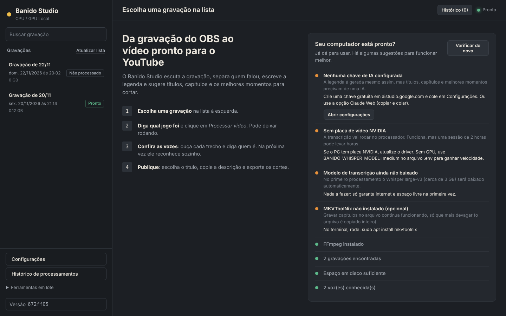
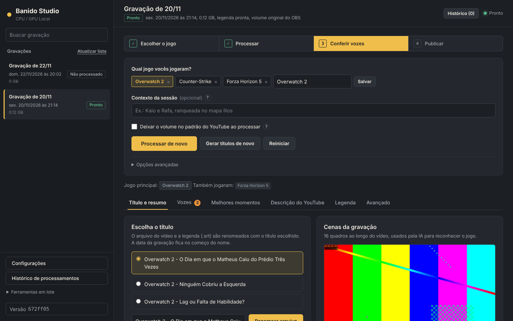
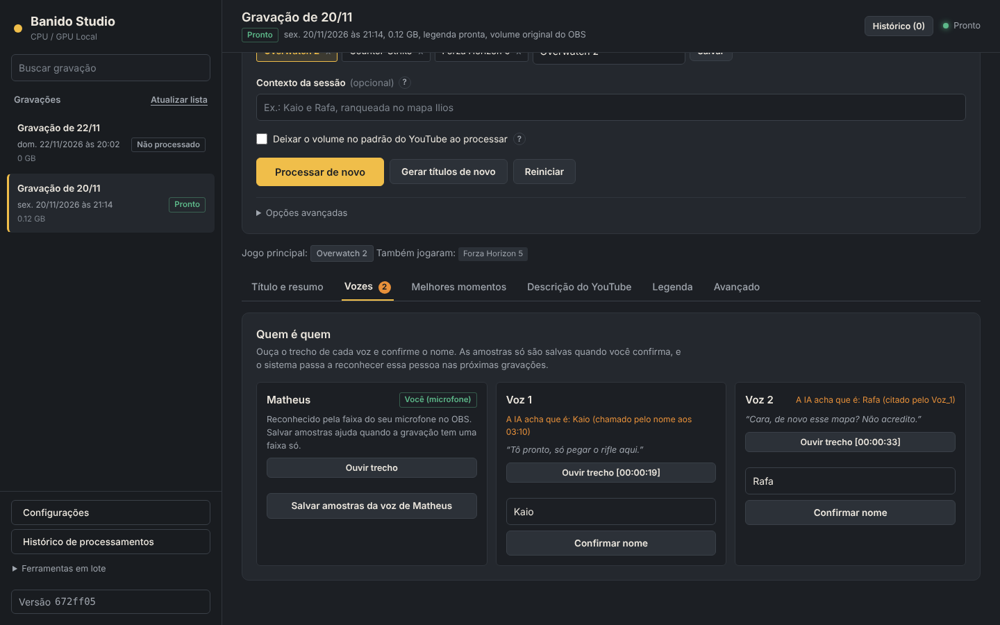
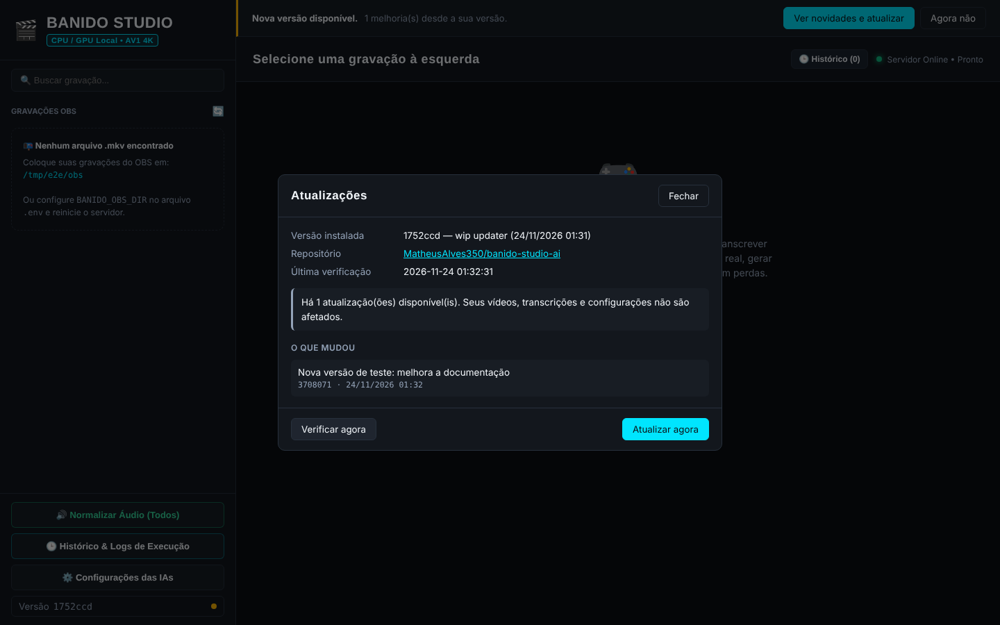

# 🎮 Banido Studio AI

Pipeline automatizado de altíssima fidelidade para processar gravações do **OBS Studio** (multi-track até **4K 60fps AV1**), transcrever diálogos com precisão, identificar vozes por biometria acústica, detectar jogos visualmente, gerar títulos/capítulos/descrições prontos para o **YouTube** e exportar cortes **100% lossless**.

---

## ⚡ Principais Recursos

- **Transcrição Ultra-Fiel (`faster-whisper`)**:
  - Usa **Whisper `large-v3`** (configurável para outros modelos/quantizações via `.env`) com `Beam Size 5`, `word_timestamps=True`, filtro anti-alucinação e suporte automático a **CUDA (float16)** com fallback para **CPU (int8)**.
  - **Pipeline Paralelo em Blocos**: extração segmentada de 5 minutos com pré-buffer e divisão em fronteira de silêncio + checkpoints incrementais em JSON (retoma vídeos longos de onde parou sem perder progresso).
- **Diarização Híbrida (Física + Biometria Vocal)**:
  - **Anfitrião (`BANIDO_HOST_NAME`)**: isolado com precisão matemática pelo diferencial de energia sonora entre a **Faixa 2 (Microfone)** e a **Faixa 3 (Discord)** em gravações multi-track, com fallback automático para gravações de 1 ou 2 faixas.
  - **Amigos / Participantes**: agrupamento acústico via **SpeechBrain ECAPA-TDNN** com Banco de Vozes evolutivo (`vozes_amigos/<Nome>/`) e player de preview direto no navegador antes de confirmar nomes e salvar amostras `.wav`.
- **Visão Multimodal de Sessão**:
  - Gera folha de contato **4x4 (16 frames com timestamp)** acelerada via NVDEC CUDA (fallback CPU) para identificar o jogo principal e trocas de jogo na sessão.
- **Diretor Criativo Multi-IA**:
  - **Google Gemini** (`google-genai`) com suporte a streaming, heartbeat em tempo real e fallback automático entre modelos.
  - **NVIDIA NIM** (endpoint compatível com OpenAI em `integrate.api.nvidia.com`) para modelos abertos hospedados na nuvem.
  - **Claude Web (1-Clique)**: copia o prompt estruturado para colar no `claude.ai` e importa a resposta JSON de volta no painel.
- **Operações 100% Lossless (Zero Re-renderização de Vídeo)**:
  - **Normalização YouTube Gold (`-15.5 LUFS`)**: pode ser executada de forma isolada, em lote **ou em Passada Única (`Single-Pass`) em paralelo com o Whisper** ao processar um vídeo (sem precisar reler nem reprocessar o MKV no final!). Reequilibra a Faixa 1 mantendo o vídeo 4K AV1 e todas as faixas auxiliares (2..N) intactas via stream copy (`-c:v copy`), com validação via `ffprobe` antes da substituição atômica.
  - **Cortes Instantâneos (e Corte Exato Opcional)**: exportação lossless de highlights em segundos via `ffmpeg -c:v copy` (dica: configure **Intervalo de Quadros-Chave = 1s ou 2s** no OBS para cortes lossless ainda mais precisos), opção **Corte exato no frame** (recodifica apenas o trecho curto para início exato), preservação de todas as faixas de áudio e proteção contra sobrescrita (`(2)`, `(3)`).
  - **Capítulos no `.mkv`**: gravação instantânea in-place com `mkvpropedit` (MKVToolNix) ou fallback lossless via FFmpeg.
  - **Renomeação Segura**: renomeia simultaneamente `.mkv` e `.srt` no padrão `DATA - JOGO - TÍTULO`, sem sobrescrever arquivos existentes.
- **Arquitetura Desacoplada, Segura & Multi-Instância**:
  - Servidor **FastAPI** leve (`<5ms` de latência) sem PyTorch/SpeechBrain na memória web + subprocessos dedicados (`app/worker.py` e coleta vocal isolada em `app/voice_bank.py`) com histórico de jobs e logs coloridos ao vivo.
  - Proteção contra CSRF local (`X-Banido-Token` gerado por sessão), validação de `Host` (`TrustedHostMiddleware`), mascaramento de chaves de API no `GET /api/settings`, travas de concorrência (`409 Conflict`) e sincronização com remoção suave/reassociação automática de arquivos renomeados fora do app.
  - 100% configurável via `.env` para rodar múltiplas instâncias, discos separados (HDD + SSD) e diferentes criadores.

---

## 🖼️ Como é a interface

| Tela inicial e diagnóstico | Vídeo processado (etapas e abas) |
| :---: | :---: |
|  |  |
| **Conferir vozes** | **Atualização pelo GitHub** |
|  |  |

*Capturas feitas com dados de demonstração.*

---

## 📋 Pré-requisitos

1. **Python 3.10+** (testado em Python 3.10 / 3.11)
2. **FFmpeg** e **FFprobe** disponíveis no `PATH` do sistema:
   - **Windows**: `winget install Gyan.FFmpeg`
   - **Ubuntu / Debian**: `sudo apt install ffmpeg`
   - **macOS**: `brew install ffmpeg`
3. **Opcional (Recomendado)**:
   - **GPU NVIDIA com CUDA** (para transcrição rápida com `faster-whisper` + `SpeechBrain` e frames via NVDEC)
   - **MKVToolNix (`mkvpropedit`)** para gravar capítulos diretamente no `.mkv` em `<0.5s`:
     - **Windows**: `winget install MoritzBunkus.MKVToolNix`
     - **Linux**: `sudo apt install mkvtoolnix`
     - **macOS**: `brew install mkvtoolnix`

---

## 🚀 Instalação e Execução Rápida

### 1. Clonar o repositório
```bash
git clone https://github.com/MatheusAlves350/banido-studio-ai.git
cd banido-studio-ai
```

### 2. Criar ambiente virtual e instalar dependências

#### Windows (PowerShell ou CMD)
```cmd
python -m venv .venv
.venv\Scripts\activate
python -m pip install --upgrade pip

:: Se tiver GPU NVIDIA (CUDA 12.1), instale PyTorch com CUDA antes:
pip install torch torchaudio --index-url https://download.pytorch.org/whl/cu121

pip install -r requirements.txt
```

#### Linux / macOS
```bash
python3 -m venv .venv
source .venv/bin/activate
python -m pip install --upgrade pip

# Opcional (Linux com GPU NVIDIA CUDA 12.1):
# pip install torch torchaudio --index-url https://download.pytorch.org/whl/cu121

pip install -r requirements.txt
```

### 3. Configurar instância (`.env`)
Copie o modelo [.env.example](.env.example) para `.env`:
```bash
cp .env.example .env
```
Se você **não** criar `.env`, tudo funcionará imediatamente usando a pasta `./data/` dentro do repositório:
- `./data/obs_recordings/` — coloque aqui seus `.mkv` (ou aponte `BANIDO_OBS_DIR` para a pasta de gravações do OBS)
- `./data/Cortes/` — cortes 4K lossless exportados
- `./data/vozes_amigos/` — banco de amostras vocais (`.wav` + `embedding.npy`)
- `./data/models/` — cache local dos modelos Whisper e SpeechBrain
- `./data/database/` — banco SQLite (`WAL`), logs e `settings.json`

### 4. Iniciar o servidor
- **Windows**: dê 2 cliques em `Iniciar_Banido_Studio.bat` (o script detecta `.venv`/`venv`, libera a porta configurada e abre o navegador automaticamente).
- **Linux / macOS**:
  ```bash
  chmod +x start.sh
  ./start.sh
  ```
- **Ou diretamente via Python**:
  ```bash
  python -m app.main
  ```

Acesse o painel em: **`http://localhost:8765`** (ou na porta definida em `BANIDO_PORT`).

---

## ⚙️ Variáveis de Ambiente (`.env`) & Múltiplas Instâncias

Todas as configurações da instância ficam centralizadas em [`app/config.py`](app/config.py) e podem ser ajustadas via `.env` ou variáveis de ambiente do sistema:

| Variável | Padrão | Descrição |
| :--- | :--- | :--- |
| `BANIDO_HOST_NAME` | `Host` | Nome do anfitrião atribuído automaticamente à Faixa 2 (microfone isolado) |
| `BANIDO_GROUP_NAME` | `Banido Studio` | Nome do canal/grupo usado no prompt criativo da IA |
| `BANIDO_BASE_DIR` | `./data` | Pasta raiz dos dados da instância (`database/`, `Cortes/`, `vozes_amigos/`, `models/`) |
| `BANIDO_OBS_DIR` | `<BASE_DIR>/obs_recordings` | Pasta monitorada para arquivos `.mkv` do OBS |
| `BANIDO_CLIPS_DIR` | `<BASE_DIR>/Cortes` | Pasta de saída dos cortes lossless |
| `BANIDO_VOICE_BANK_DIR` | `<BASE_DIR>/vozes_amigos` | Diretório de perfis vocais conhecidos |
| `BANIDO_MODELS_DIR` | `<BASE_DIR>/models` | Diretório de cache dos modelos Whisper / SpeechBrain |
| `BANIDO_TEMP_DIR` | Temp do SO (`/BanidoStudioTemp`) | Pasta para extração temporária de áudio (ideal apontar para um **SSD NVMe**) |
| `BANIDO_PYTHON` | Python atual (`sys.executable`) | Caminho explícito do interpretador Python para os workers |
| `BANIDO_HOST` | `127.0.0.1` | Endereço de bind do servidor FastAPI |
| `BANIDO_ACCESS_PASSWORD` | _(vazio)_ | Senha de acesso. **Obrigatória** se `BANIDO_HOST` não for local (ex.: `0.0.0.0`): sem ela, o servidor recusa todas as requisições. Com ela, quem acessar pela rede vê uma tela de login (cookie de sessão por 7 dias; reiniciar o servidor encerra as sessões). Use só em redes de confiança: a conexão é HTTP, sem criptografia. |
| `BANIDO_PORT` | `8765` | Porta HTTP da instância |
| `BANIDO_WHISPER_MODEL` | `large-v3` | Modelo do `faster-whisper` (`large-v3`, `large-v3-turbo`, `medium`, `small`, etc.) |
| `BANIDO_WHISPER_DEVICE` | `auto` | Dispositivo (`auto`, `cuda` ou `cpu`) |
| `BANIDO_WHISPER_COMPUTE_TYPE` | `auto` | Precisão (`auto`, `float16`, `int8_float16`, `int8`) |
| `BANIDO_WHISPER_LANGUAGE` | `pt` | Idioma da transcrição (`pt`, `en`, `auto`, etc.) |
| `BANIDO_SEPARATE_TRACKS` | `1` | Com microfone isolado (6 ou 2 faixas), transcreve microfone e Discord separadamente e mantém falas sobrepostas. Usa o Whisper duas vezes por bloco (mais lento, mais fiel). `0` volta ao mix único. |
| `GOOGLE_API_KEY` | *(vazio)* | Chave da API Google Gemini (opcional; também pode ser salva pela interface) |
| `NVIDIA_API_KEY` | *(vazio)* | Chave da API NVIDIA NIM (opcional; também pode ser salva pela interface) |

### Exemplo para rodar 2ª instância ou discos separados (HDD + SSD)
```env
BANIDO_HOST_NAME=SeuNome
BANIDO_GROUP_NAME=SeuCanal
BANIDO_BASE_DIR=D:/BanidoStudio
BANIDO_OBS_DIR=D:/Videos/OBS
BANIDO_TEMP_DIR=C:/BanidoStudioTemp
BANIDO_PORT=8766
```
Cada instância mantém seu próprio SQLite, logs, banco de vozes e porta HTTP de forma totalmente isolada.

---

## 🔐 Segurança e Chaves de API

- **Nenhuma chave de API fica armazenada no código-fonte.**
- As chaves podem ser informadas na interface Web (`⚙️ Configurações das IAs` → salvas localmente em `<BASE_DIR>/database/banido_studio.db` e `settings.json`) **ou** via `.env` (`GOOGLE_API_KEY` / `NVIDIA_API_KEY`).
- O endpoint `GET /api/settings` devolve **apenas a versão mascarada** das chaves (ex.: `AIza...1234`), exigindo o token de sessão (`X-Banido-Token`) gerado no boot do servidor, e o `TrustedHostMiddleware` restringe o cabeçalho `Host` a `localhost`/`127.0.0.1` por padrão (configurável via `BANIDO_ALLOWED_HOSTS`).
- O `.gitignore` bloqueia explicitamente `.env`, `.env.local`, `data/`, `database/`, `settings.json`, `obs_backups/`, `*.db*`, `logs/`, `temp/`, `models/`, `Cortes/`, `vozes_amigos/`, `obs_recordings/` e arquivos de mídia (`.mkv`, `.mp4`, `.wav`, `.srt`, `.npy`).

---

## 🎙️ Layout de Áudio do OBS Studio (Recomendado)

Para extrair 100% do potencial da diarização física e da normalização YouTube Gold, configure o OBS para gravar em **`.mkv`** com **6 faixas de áudio**:

1. **Faixa 1**: Mix Geral (todas as fontes)
2. **Faixa 2**: Microfone isolado do anfitrião
3. **Faixa 3**: Áudio isolado do Discord / call
4. **Faixa 4**: Áudio do jogo
5. **Faixa 5**: Áudio do desktop / navegador
6. **Faixa 6**: Soundpad / efeitos (usado na telemetria de hype)

> **Nota**: Gravações com **2 faixas** (Mix/Discord + Mic) ou **1 faixa** (Mix único) também funcionam — o pipeline detecta a contagem de streams automaticamente e ajusta o fluxo.

O utilitário opcional `python -m app.obs_fixer` faz backup da cena ativa do OBS e aplica o roteamento multi-track padrão automaticamente.

---

## 🧭 Fluxo de Uso na Interface

Ao abrir o painel sem nenhuma gravação selecionada, a tela inicial explica o fluxo e mostra o quadro **"Seu computador está pronto?"**, que verifica FFmpeg, pasta do OBS, chave de IA, placa de vídeo, modelo do Whisper, espaço em disco, MKVToolNix e banco de vozes, dizendo em linguagem simples como resolver cada item.

Com uma gravação selecionada, a faixa de etapas no topo mostra onde você está:

1. **Escolher o jogo**: clique num jogo recente ou digite o nome. O **contexto da sessão** (opcional) ajuda a IA a acertar nomes e apelidos.
2. **Processar**: marque **Deixar o volume no padrão do YouTube** se quiser, e clique em **Processar vídeo**. A escolha da IA (Gemini, NVIDIA ou Claude Web) e o ajuste só de volume ficam em **Opções avançadas**.
3. **Conferir vozes**: na aba **Vozes**, ouça o trecho de cada pessoa e confirme o nome. O número na aba mostra quantas vozes ainda faltam.
4. **Publicar**: nas abas de resultado:
   - **Título e resumo**: escolha o título e renomeie o `.mkv` e o `.srt`;
   - **Melhores momentos**: ouça a prévia, ajuste início e fim e exporte os cortes sem perda de qualidade;
   - **Descrição do YouTube**: copie a descrição com capítulos e as tags;
   - **Legenda**: busque qualquer frase dita na sessão;
   - **Avançado**: grave capítulos dentro do `.mkv` e use o Claude pelo navegador (copiar e colar).

Os botões **?** ao lado dos termos técnicos explicam o que cada opção faz.

---

## 🔄 Atualizações pelo GitHub

O painel avisa quando existe uma versão nova no GitHub e atualiza com 1 clique:

1. Uma faixa **"Nova versão disponível"** aparece no topo (ou clique em **Versão** no rodapé do menu lateral).
2. **Ver novidades e atualizar** mostra a lista do que mudou.
3. **Atualizar agora** baixa o código (`git fetch` + `git merge --ff-only`) e, se o `requirements.txt` mudou, roda `pip install -r requirements.txt` sozinho.
4. **Reiniciar para concluir** reinicia o servidor e recarrega a página.

Regras de segurança:
- Só funciona em instalações feitas com **`git clone`** (cópias baixadas como ZIP recebem apenas o aviso com o link).
- A atualização é **bloqueada** se houver vídeo em processamento, arquivos do projeto alterados localmente ou commits locais não publicados — nada é sobrescrito.
- Seus dados (`data/`, `.env`, gravações, banco de vozes) ficam fora do Git e não são tocados.
- O reinício automático depende de abrir o sistema pelo `Iniciar_Banido_Studio.bat` ou `./start.sh` (eles reiniciam o servidor quando ele sai com o código 3).

---

## 🛠️ Solução de Problemas

- **GPU com 4 GB ou 6 GB de VRAM (Out of Memory no Whisper)**:
  Defina no `.env`:
  ```env
  BANIDO_WHISPER_MODEL=medium
  BANIDO_WHISPER_COMPUTE_TYPE=int8_float16
  ```
- **Sem GPU NVIDIA**:
  Não é necessário configurar nada — o sistema detecta a ausência de CUDA e roda Whisper em `cpu` (`int8`) e SpeechBrain em `cpu`. Para evitar avisos, você pode fixar `BANIDO_WHISPER_DEVICE=cpu`.
- **`ffmpeg` ou `ffprobe` não encontrado**:
  Verifique no terminal com `ffmpeg -version` e `ffprobe -version` e garanta que estão no `PATH`.
- **Mosaico / Preview não atualiza após trocar `.env`**:
  Reinicie o servidor (`Iniciar_Banido_Studio.bat` ou `./start.sh`) para recarregar as variáveis de ambiente e os pontos de montagem estáticos.

---

## 📂 Estrutura do Projeto

```text
├── app/
│   ├── main.py               # Servidor FastAPI e API REST
│   ├── worker.py             # Subprocesso isolado para GPU/FFmpeg/IA
│   ├── config.py             # Configuração portável via .env / ambiente
│   ├── database.py           # SQLite (WAL) + sincronização e histórico de jobs
│   ├── audio_pipeline.py     # Extração paralela, energia multifaixa e telemetria de hype
│   ├── transcriber_v3.py     # Pipeline Whisper + checkpoints + exportação .SRT
│   ├── voice_bank.py         # Diarização e biometria vocal (SpeechBrain ECAPA-TDNN)
│   ├── mosaic_generator.py   # Folha de contato 4x4 para visão multimodal
│   ├── ai_director.py        # Prompts, Gemini, NVIDIA NIM, Claude Web e metadados YT
│   ├── lossless_media.py     # Normalização YouTube Gold, cortes e capítulos MKV
│   ├── updater.py            # Verificação e aplicação de atualizações via GitHub (git)
│   ├── obs_fixer.py          # Utilitário opcional de roteamento multi-track no OBS
│   └── static/               # Interface Web (index.html, app.js, style.css)
├── docs/
│   └── ARCHITECTURE.md       # Detalhes técnicos da arquitetura
├── tests/
│   └── test_core.py          # Testes unitários e de API (pytest)
├── .github/workflows/
│   └── ci.yml                # Pipeline CI (AST, Ruff, pytest, JS check)
├── .env.example              # Modelo completo de configuração por instância
├── .gitattributes            # Normalização LF/CRLF entre Linux/macOS e Windows
├── .gitignore                # Proteção contra commit de chaves, dados e mídia
├── Iniciar_Banido_Studio.bat # Inicializador portável para Windows
├── start.sh                  # Inicializador portável para Linux/macOS
└── requirements.txt
```

---

## 🧪 Testes Automatizados

Os testes não precisam de GPU, PyTorch nem Whisper — só das dependências leves de `requirements-dev.txt` (as mesmas usadas no GitHub Actions):

```bash
pip install -r requirements-dev.txt
pytest -q
ruff check app tests --select E9,F63,F7,F82,F401,F541,F841
```
