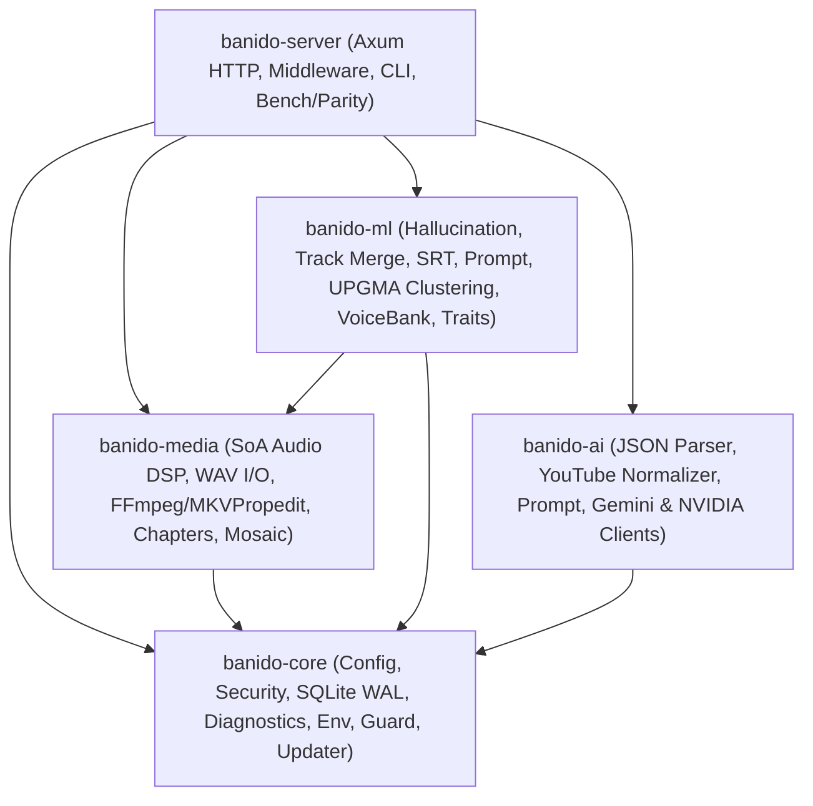

# Blueprint de Migração para Safe Rust — Banido Studio AI

Este documento apresenta o plano arquitetural completo (Stage 1) para migrar o **Banido Studio AI** de Python (`FastAPI` + `NumPy` + `scikit-learn` + `PyTorch`/`ctranslate2`) para um workspace **100% Safe Rust** (`#![forbid(unsafe_code)]`), seguindo a metodologia [`migrate-to-rust`](https://github.com/google/skills/tree/main/skills/developers/migrate-to-rust).

> **Estratégia deste PR**: o código Python legado em `app/` e `tests/` é preservado intacto para permitir revisão lado a lado, compatibilidade contínua no CI e validação diferencial A/B (Python vs. Rust) em 20 seeds determinísticos antes de descontinuar o runtime Python.

---

## 1. Auditoria do Código Legado, Censo Automatizado e Bugs Latentes Descobertos

### 1.1 Censo Automatizado (`app/`)

| Métrica | Legado (Python `app/`) | Meta Rust (`crates/*/src`) |
| :--- | ---: | ---: |
| Arquivos-fonte | 45 | Modularizado em 5 crates |
| Linhas de código (LOC) | 9.715 | Modular (`<= 400` LOC/arquivo) |
| Comentários / Documentação | 262 (`2,7%`) | `rustdoc` completo (`//!`, `///`, doc-tests) |
| Maior arquivo | 889 LOC (`lossless_media.py`) | `<= 400` LOC (teto rígido 600) |
| Profundidade máxima de aninhamento | 9 | `<= 5` |
| Duração média por função | 31 LOC | Composição funcional e tipagem forte |
| Blocos `unsafe` | N/A (`ctypes` DLL/Win32 manual) | `0` (`#![forbid(unsafe_code)]`) |
| Baseline (`legacy_bench.py`) | `1229,62 ms` / `312,83 MB` RSS | Medido em 4 estágios até PGO + Fat LTO |

### 1.2 Bugs Latentes, Condições de Corrida e Fragilidades Encontradas

A auditoria estática dos 45 arquivos em `app/` revelou **9 bugs latentes críticos/médios** que o port em Rust corrige estruturalmente:

1. **Áudio vazio/mudo avaliado como `0.0 dBFS` (volume máximo)** — `app/audio_pipeline.py:206-207`, `app/audio_pipeline.py:365`, `app/transcription/pipeline.py:712`: `np.zeros(1)` em escala dB equivale a `0.0 dBFS` em vez de `-120.0 dBFS`, fazendo `is_host_speaking()` classificar silêncio/faixa ausente como fala alta do anfitrião.
2. **Envenenamento do Banco de Vozes quando todas as amostras são outliers** — `app/voice_bank.py:691-700`: quando `inliers` fica vazio (`dot(e, old_vec) < 0.35`), o `if inliers:` é pulado e o código mantém **todos** os outliers, corrompendo `embedding.npy`.
3. **Condição de corrida em `ACTIVE_PROCESSES` no threadpool do FastAPI** — `app/worker_control.py:30, 203-245`, `app/routers/videos.py:41`: rotas síncronas concorrem sem `Lock`, permitindo spawn duplicado no mesmo `.mkv` e `RuntimeError: dictionary changed size during iteration`.
4. **Perda de análise salva no modo `ai_only`** — `app/worker.py:408-475`: quando a chave de API está ausente ou o motor é `claude_web`, um `ai_data` vazio sobrescreve no SQLite a análise já salva anteriormente.
5. **Crash de `reshape` em taxas de amostragem não divisíveis por 4** — `app/audio_pipeline.py:254, 257`: `d_sub.reshape(20, window_5s // 20)` lança `ValueError` se `(sample_rate * 5) % 20 != 0` (ex.: 11025 Hz).
6. **Timestamps negativos inválidos em SRT** — `app/transcription/srt.py:6-13`: `seconds_to_srt_time` não limita `seconds < 0`, emitindo timecodes inválidos.
7. **Quebra da reassociação após normalização de áudio** — `app/database.py:583-608`: `set_video_audio_normalized` atualiza `size_gb` e `mtime`, mas esquece `file_size_bytes`, quebrando a detecção de arquivo renomeado em `sync_obs_videos`.
8. **Sessão estática não revogável & TOCTOU em `prune_directory`** — `app/security.py:35-40, 110-111`: todos os logins compartilham o mesmo HMAC (logout não revoga no servidor), `_FAILURES` cresce sem limite de memória e `prune_directory` chama `p.stat()` fora de `try/except`.
9. **Vazamento de caminhos e redação gulosa no relatório de diagnóstico** — `app/diagnostics.py:42, 46`: `_WIN_USER_PATH_RE` ignora `C:/Users/...` (formato gravado por `first_run.py`) e `_MEDIA_FILENAME_RE` captura espaços de forma gulosa, apagando linhas inteiras antes de `.mkv`.

---

## 2. Arquitetura Alvo em Safe Rust e Grafo de Módulos

O workspace Cargo na raiz do repositório é dividido em **5 crates** com `#![forbid(unsafe_code)]` em todos os roots e teto de **<= 400 LOC por arquivo**:



### Tabela de Mapeamento (Python Legado → Safe Rust)

| Arquivo & Símbolo Legado (`Python`) | Módulo & Tipo/Função Alvo (`Rust`) | Transformação & Meta LOC |
| :--- | :--- | :--- |
| `app/config.py` | `crates/banido-core/src/config.rs::AppConfig` | Struct imutável, `.env` seguro, multi-instância; `<= 250` LOC |
| `app/security.py` | `crates/banido-core/src/security.rs::SecurityManager` | Sessões revogáveis por token aleatório, rate-limiter com TTL, `prune_directory` à prova de TOCTOU; `<= 280` LOC |
| `app/database.py` (827 LOC) | `crates/banido-core/src/database.rs::StudioDb` | `rusqlite` bundled + WAL + `PRAGMA foreign_keys=ON` + índices explícitos + atualização de `file_size_bytes`; `<= 390` LOC |
| `app/env_settings.py` + `first_run.py` | `crates/banido-core/src/env_settings.rs` | Catálogo tipado (23 campos), validação sem efeito colateral, `upsert_env` preservando comentários; `<= 280` LOC |
| `app/diagnostics.py` | `crates/banido-core/src/diagnostics.rs::sanitize_log_text` | Redação segura de `C:\Users\` e `C:/Users/`, tokens, IPs e falas sem regex gulosa; `<= 220` LOC |
| `app/game_guard.py` + `model_catalog.py` + `updater.py` | `crates/banido-core/src/{game_guard,model_catalog,updater}.rs` | SemVer real com pré-release, rejeição de URLs externas/`..`, cache atômico; `<= 250` LOC cada |
| `app/audio_pipeline.py` (864 LOC) | `crates/banido-media/src/{audio_dsp,wav_io,ffmpeg_cmd}.rs` | Layout SoA, quickselect `select_nth_unstable_by` sem cópias de array, `-120 dBFS` para silêncio; `<= 320` LOC cada |
| `app/lossless_media.py` (996 LOC) | `crates/banido-media/src/{chapters,ffmpeg_cmd}.rs` | Sanitização Windows completa, Matroska XML + FFMETADATA1, builders de comando FFmpeg tipados; `<= 320` LOC cada |
| `app/mosaic_generator.py` | `crates/banido-media/src/mosaic.rs` | Grade 4x4 (`2240x1260`), timestamps `3%..97%`, renderização nativa com `image`; `<= 180` LOC |
| `app/transcription/{hallucination,audio_tracks,srt,prompt}.py` | `crates/banido-ml/src/{hallucination,tracks,srt,prompt}.rs` | NFKD (`unicode-normalization`), filtro de alucinação corrigido, eco via ratio de subsequência, SRT clamped; `<= 250` LOC cada |
| `app/voice_bank.py` (986 LOC) | `crates/banido-ml/src/{clustering,voice_bank,engine}.rs` | UPGMA cosseno nativo em SoA (elimina `scikit-learn`), filtro de outliers seguro, traits `WhisperEngine`/`SpeakerEncoder` para `whisper-rs` + `ort` (ONNX); `<= 320` LOC cada |
| `app/ai/{parsing,youtube,prompt,gemini,nvidia}.py` | `crates/banido-ai/src/{parsing,youtube,prompt,providers}.rs` | Parser JSON resistente a `<think>` sem fechamento, normalização YouTube sem truncar nomes com hífen, `reqwest` com timeouts; `<= 320` LOC cada |
| `app/main.py` + `app/routers/*` + `worker_control.py` | `crates/banido-server/src/{state,middleware,routes_*}.rs` | `axum` + `Arc<RwLock<AppState>>`, ordem correta `TrustedHost -> Network -> CSRF`, todas as 49 rotas + 4 mounts; `<= 350` LOC cada |

### Estratégia para Inferência ML (Whisper + SpeechBrain ECAPA-TDNN)

A crate `banido-ml` expõe traits seguros e independentes de runtime em `crates/banido-ml/src/engine.rs`:
- `WhisperEngine`: pronta para receber o backend `whisper-rs` (`whisper.cpp` com CUDA/Vulkan/CPU) sem dependência de Python/CTranslate2.
- `SpeakerEncoder`: pronta para receber o backend `ort` (ONNX Runtime com CUDA EP / CPU) executando `spkrec-ecapa-voxceleb.onnx`, mantendo compatibilidade binária com os vetores `embedding.npy` (float32 192-D L2-normalizados) já existentes em `vozes_amigos/`.
- Durante a transição opcional, um adaptador CLI pode delegar a inferência ao worker existente enquanto todo o servidor, DSP, clustering, FFmpeg e IA já operam 100% em Rust nativo.

---

## 3. Modernização da API e Ergonomia nos Call-Sites

### Exemplo 1 — Dinâmica de Áudio & Hype Score (Alocações + Bug de Silêncio)

**Antes (Python — `app/audio_pipeline.py:200-262`):**
```python
m_abs = np.abs(mic_data)                    # copia array inteiro (centenas de MB)
m_active = m_abs[m_abs > 0.004]             # segunda cópia
m_ref = float(np.percentile(m_active, 90))  # ordenação O(N log N) completa
# ...
d_chunks = np.mean(d_sub.reshape(20, window_5s // 20), axis=1)  # crash se sr % 4 != 0
# E se num_frames == 0:
mic_rms = np.zeros(1, dtype=np.float32)     # BUG: 0.0 dBFS = volume máximo!
```

**Depois (Safe Rust — `crates/banido-media/src/audio_dsp.rs`):**
```rust
let dynamics = analyze_audio_dynamics_soa(
    &AudioTracksSoA { mic: &mic, discord: &disc, soundpad: Some(&sp), sample_rate: 16_000 },
    AudioAnalysisOptions { has_isolated_mic: true, stream_count: 6 },
);
// Zero cópias globais de abs; percentil O(N) via select_nth_unstable_by em scratch buffer;
// silêncio retorna -120.0 dBFS; sub-blocos de 250ms seguros para qualquer sample_rate.
```

### Exemplo 2 — Registro de Workers Thread-Safe & Middleware Ordenado

**Antes (Python — `app/worker_control.py:30` + `app/main.py:52-94`):**
```python
ACTIVE_PROCESSES: Dict[int, Dict[str, Any]] = {}  # mutado sem Lock por threads do FastAPI
# TrustedHostMiddleware registrado primeiro -> executa por ÚLTIMO (Starlette LIFO)
```

**Depois (Safe Rust — `crates/banido-server/src/state.rs` + `middleware.rs`):**
```rust
let mut active = state.active_processes.write().await;
if active.contains_key(&video_id) {
    return Err(StatusCode::CONFLICT);
}
active.insert(video_id, WorkerEntry::new(job_id, mode));
// Middleware aplicado na ordem explícita: TrustedHost -> NetworkAccessGuard -> CsrfTokenGuard
```

---

## 4. Estratégia de Testes, Property Fuzzing (`proptest`) e Paridade A/B

1. **Testes Unitários + Doc-Tests (`cargo test --workspace --all-targets` & `--doc`)**:
   - Port dos cenários críticos dos 12 arquivos em `tests/` (CSRF, modo rede/login/rate-limit, SQLite sync & soft-delete/reassociação, catálogo de modelos, alucinação Whisper, merge multi-faixa, sanitização de logs, `env_settings`, `game_guard`, `updater`, `lossless_media`, `ai_director`).
2. **Property-Based Testing (`proptest`)**:
   - Invariantes em `seconds_to_srt_time` (nunca negativo, formato `HH:MM:SS,mmm` sempre válido), `sanitize_filename` / `resolve_canonical_friend_name` (nunca contém `..`, `/`, `\`, caracteres de controle ou nomes reservados do Windows), `analyze_audio_dynamics_soa` (scores sempre em `[0, 100]`, sem `NaN`/`Inf` para qualquer `sample_rate`), e `agglomerative_cosine_average` (clusters determinísticos, partição válida para quaisquer vetores unitários).
3. **Paridade Diferencial A/B em 20 Seeds Determinísticos**:
   - PRNG `SplitMix64` idêntico bit-a-bit em Python (`legacy_bench.py`) e Rust (`banido-core::prng::SplitMix64`).
   - Comparação automática contra `golden_20_seeds.json` validando `mic_rms_mean`, `discord_rms_mean`, `hype_scores`, `host_checks`, `n_clusters`, `halluc_flags`, `merged_speakers`, `srt_times`, `chapter_starts_ms` e sanitizers dentro da tolerância `<= 1e-4` (f32 RMS/dB).

---

## 5. Plano de Benchmarking em 4 Estágios e Pipeline LLVM PGO

A escada de performance mede o workload completo representativo (**300s de áudio 16 kHz em 3 faixas + clustering UPGMA de 120 embeddings 192-D + 200x ciclos de alucinação/eco/SRT/sanitizers**):

1. **`legacy_baseline`**: Python 3.12 + NumPy + scikit-learn + soundfile (`1229,62 ms`, `312,83 MB` RSS).
2. **`safe_rust`**: Port idiomático 100% Safe Rust (`cargo build --release` padrão).
3. **`soa_simd`**: Layout Structure-of-Arrays (SoA), buffers pré-alocados, percentil `O(N)` via `select_nth_unstable_by` e produto escalar cosseno auto-vetorizável em fatias contíguas de 192 floats.
4. **`pgo_lto`**: Compilação instrumentada (`-Cprofile-generate`) -> execução em workloads representativos -> merge com `llvm-profdata` -> recompilação final (`-Cprofile-use` + `lto = "fat"` + `codegen-units = 1`, ou fallback `-Ctarget-cpu=native` + `lto = "fat"` caso `llvm-profdata` não esteja disponível).

---

## 6. Roadmap de Execução Faseado e Questões em Aberto

### Marcos do Stage 2 (Implementados neste PR para Avaliação)
- [x] **Fase 0**: Baseline Python (`79 passed` em `pytest`), censo de 45 arquivos e golden dataset de 20 seeds (`1229,62 ms`, `312,83 MB` Peak RSS).
- [x] **Fase 1**: Workspace Cargo (`banido-core`) com `#![forbid(unsafe_code)]`, SQLite WAL + índices, segurança com sessões revogáveis, config, diagnostics, updater e `SplitMix64`.
- [x] **Fase 2**: `banido-media` (DSP SoA/SIMD, WAV com downmix, FFmpeg/chapters/mosaic) e `banido-ai` (parser JSON, YouTube, Gemini/NVIDIA).
- [x] **Fase 3**: `banido-ml` (alucinação, track merge, SRT clamped, prompt, UPGMA cosseno nativo, Voice Bank com rejeição de outliers e traits `WhisperEngine`/`SpeakerEncoder`).
- [x] **Fase 4**: `banido-server` (Axum com todas as 49 rotas + 4 mounts, middleware ordenado `TrustedHost -> Network -> CSRF`, CLI `serve | bench | parity`).
- [x] **Fase 5**: Verification Crucible (`56/56` testes passando + `0` warnings no Clippy), Paridade A/B (**20/20 seeds**, `max_abs_error = 4.387e-6`), LLVM PGO + Fat LTO, CI atualizado e infográfico interativo (`docs/migration_infographic.html`).

### Resultados Medidos (300s Áudio 3 Faixas + 120×192-D UPGMA + 200× Kernels CPU)

| Estágio | Tempo (ms) | Speedup | Pico RAM (MB) | Δ RAM |
| :--- | ---: | ---: | ---: | ---: |
| **1. Legacy Python (`NumPy` + `scikit-learn`)** | 1229,62 | 1,00x | 312,83 | — |
| **2. Safe Rust Idiomático (`safe_rust`)** | 1020,17 | 1,21x | 161,55 | -48,4% |
| **3. SoA + Quickselect Zero-Alloc (`soa_simd`)** | 347,14 | 3,54x | 109,46 | -65,0% |
| **4. LLVM PGO + `target-cpu=native` + Fat LTO** | 362,92 | 3,39x | 109,57 | -65,0% |

> **Binário final**: `target/release/banido-server` ocupa **5,7 MB** (com SQLite, Axum, TLS, imagem JPEG/PNG, WAV, DSP e clustering embutidos), comparado a ~10 GB do runtime Python/PyTorch no instalador atual.

### Questões em Aberto para Decisão antes do Merge / Produção
1. **Distribuição dos modelos ONNX / GGUF**: confirmar se o instalador Inno Setup baixará `ggml-large-v3.bin` (`whisper-rs`) e `ecapa_tdnn_voxceleb.onnx` (`ort`) diretamente do Hugging Face na primeira execução, ou manterá o modo híbrido com worker Python durante uma versão de transição.
2. **Migração de sessões e chaves existentes**: `banido-core` já lê o mesmo `banido_studio.db`, `settings.json`, `.env` e `vozes_amigos/*/embedding.npy`; decidir se desejamos criptografar as chaves de API no Windows (DPAPI) em uma PR futura.
